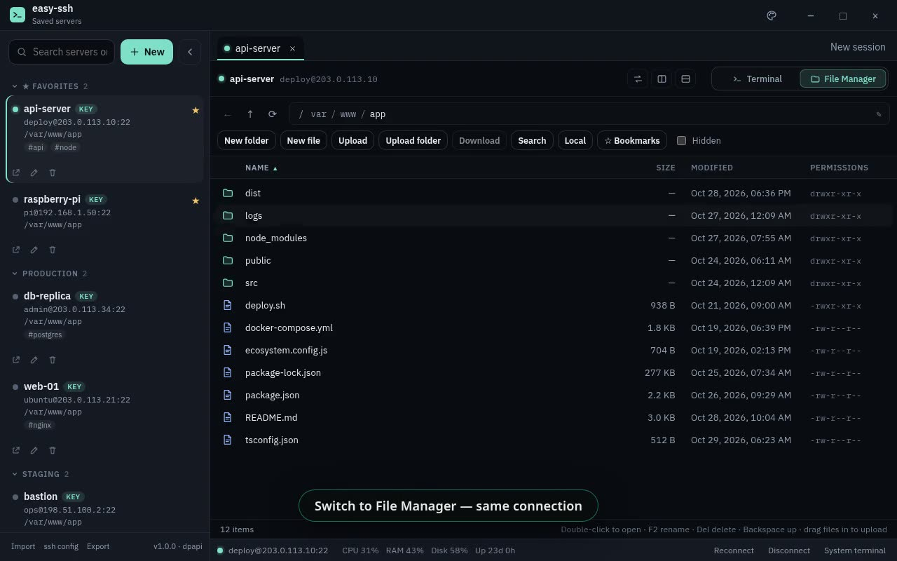
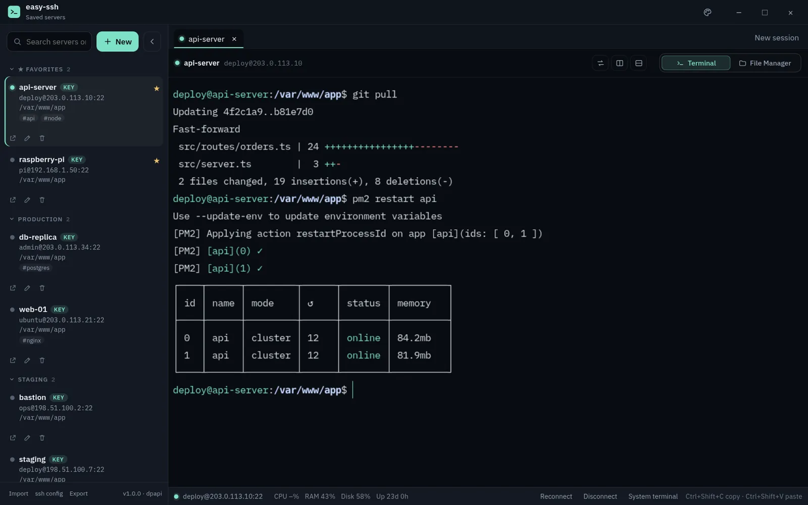
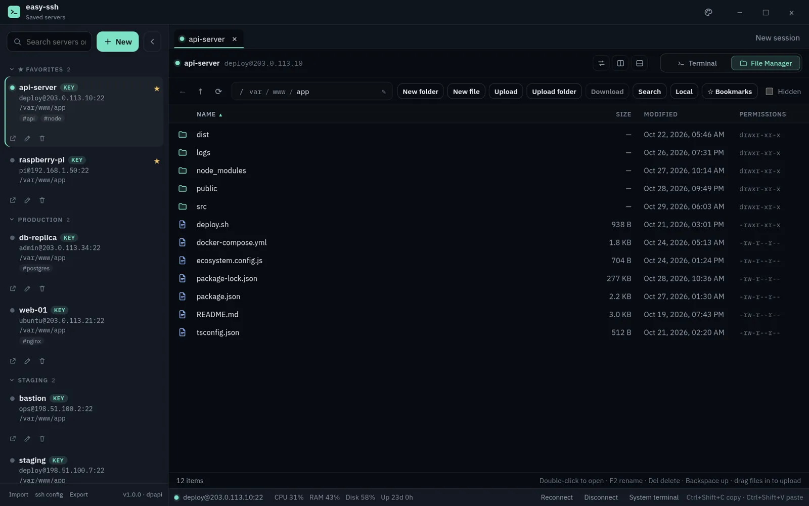
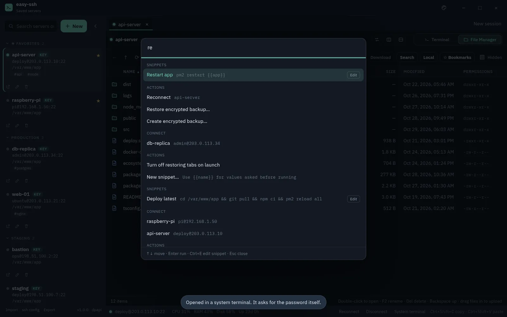
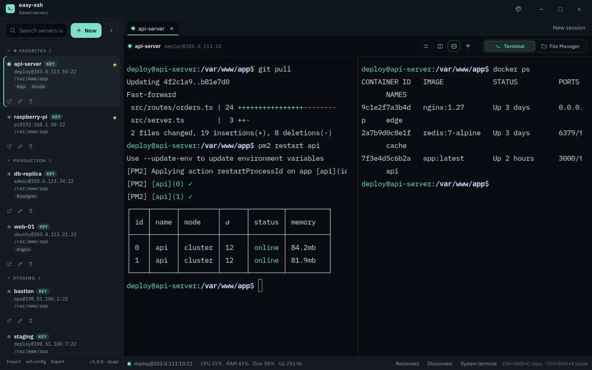
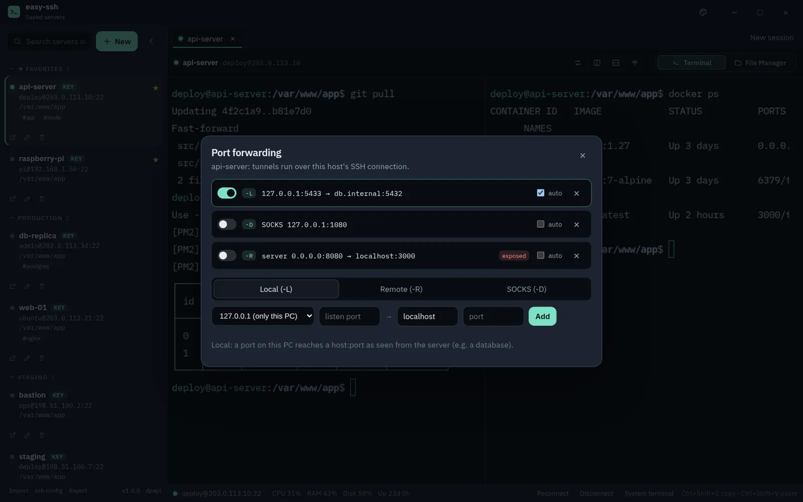
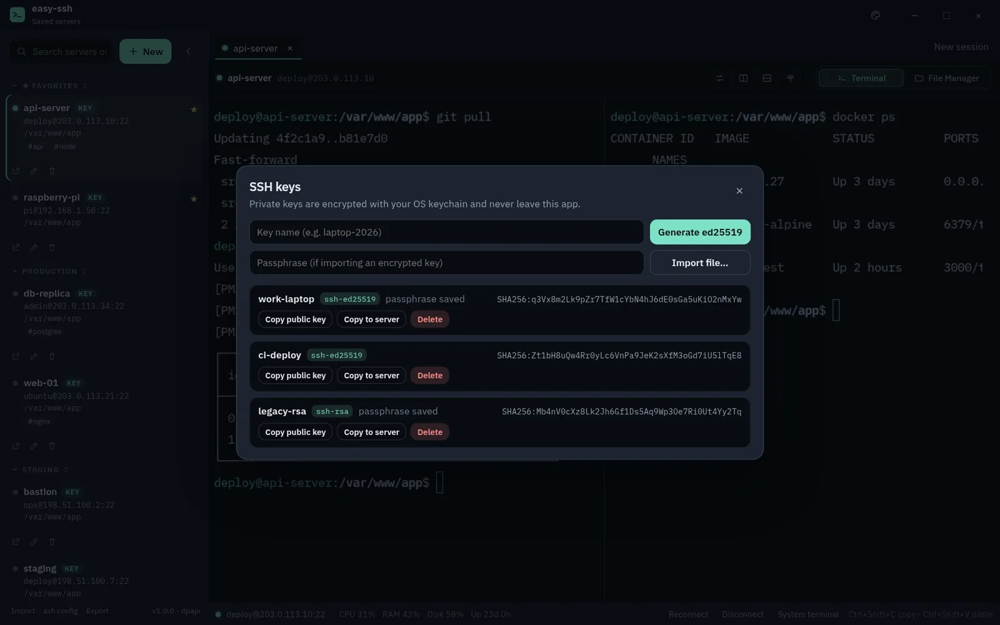
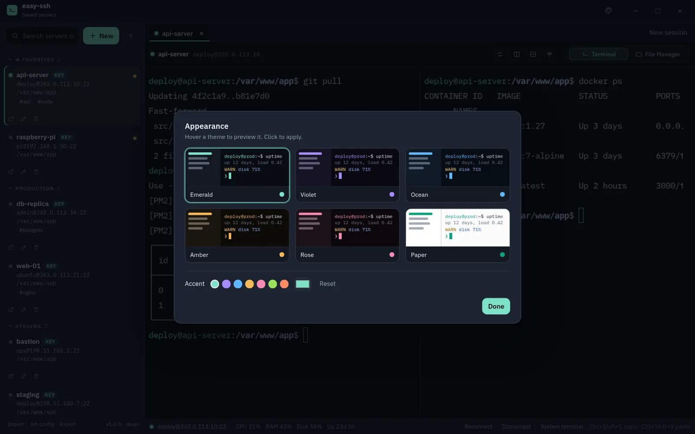
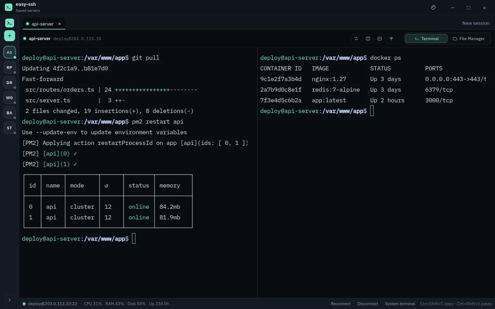
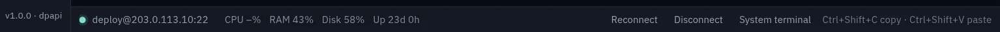

<div align="center">

# ⚡ easy-ssh

### SSH without the headache.

**Save your servers, connect in one click, and switch between a fast terminal and a full file manager over the same connection.**

[](https://github.com/taimoorKVD/easy-ssh/releases/latest)
[](https://github.com/taimoorKVD/easy-ssh/releases)
[](LICENSE)
[](https://www.electronjs.org)
[](https://www.typescriptlang.org)
[](https://github.com/taimoorKVD/easy-ssh/actions/workflows/release.yml)

<a href="https://github.com/taimoorKVD/easy-ssh/releases/latest/download/easy-ssh-Setup.exe"></a>

<sub>Windows 10/11 (64-bit) · macOS & Linux coming soon · Free & open source (MIT)</sub>

<br><br>

<a href="docs/media/demo.mp4"></a>

<sub>▶ <b><a href="docs/media/demo.mp4">Watch the 30-second demo</a></b> (click the image)</sub>

</div>

---

A desktop SSH client for the connections you open all the time. Save the host, port, user and folder, then connect in one click. easy-ssh logs in, `cd`s into that directory, runs any startup commands, and leaves you an interactive shell.

Windows is the primary target. The same app runs on macOS and Linux, and installers for those platforms are coming soon.

> 🌐 Landing page source: **[taimoorKVD/easy-ssh-website](https://github.com/taimoorKVD/easy-ssh-website)**

## ✨ Features

<table>
<tr>
<td width="50%"><br><b>⌁ Terminal + File Manager</b>: switch modes in one tab. SFTP rides the same SSH connection, so there's no second login.</td>
<td width="50%"><br><b>✎ File Manager extras</b>: remote search, edit in VS Code with auto-upload, a local pane, a resumable queue and bookmarks.</td>
</tr>
<tr>
<td><br><b>⌘ Ctrl+K snippets palette</b>: encrypted snippets with <code>{{placeholders}}</code>, safely quoted so values can't inject commands.</td>
<td><br><b>▦ Split panes + broadcast</b>: several terminals side by side; type into all of them at once.</td>
</tr>
<tr>
<td><br><b>⇄ Port forwarding</b>: local, remote and SOCKS tunnels per host, with on/off toggles.</td>
<td><br><b>⚿ Key manager</b>: generate or import keys and copy your public key to a server in one click.</td>
</tr>
<tr>
<td><br><b>◐ Themes</b>: six themes with live preview plus a custom accent colour.</td>
<td><br><b>▤ Live server stats</b>: CPU, RAM, disk and uptime in a slim bar that warns when things run hot.</td>
</tr>
</table>

Also included:
- **⤳ Jump hosts:** reach private servers through a bastion picked from your saved hosts.
- **↻ Auto-reconnect & tab restore:** reconnects after network drops and reopens the last session's tabs.
- **◫ tmux support:** optionally attach sessions to tmux so work survives disconnects.
- **⛁ Encrypted backup:** export hosts and snippets to a passphrase-protected `.essh` file.

<p align="center"></p>

**The basics:**
- Save, edit, delete and search connections. Each one can have an optional group, a default remote directory and startup commands (one per line).
- Authenticate with a password or a private key file with an optional passphrase.
- Embedded terminal tabs (xterm.js over [ssh2](https://github.com/mscdex/ssh2)). You can keep several tabs open, including more than one session on the same server.
- Wrong passwords and dropped connections stay in the tab with a reconnect option. You can replace a rejected password without editing the whole connection.
- **Open in system terminal** launches the OS terminal with `ssh`. The saved password is not injected.
- Import and export connections as JSON. Passwords and passphrases are left out of the file.

> Screenshots and the demo use fake demo data (documentation IP ranges such as `203.0.113.x`).

## 🔒 Security first, not an afterthought

| | |
|---|---|
| **OS-encrypted secrets** | Saved passwords, private keys and snippets are encrypted with your OS's secure storage (Windows DPAPI via Electron `safeStorage`). |
| **Host key verification** | Every server's fingerprint is remembered. If it changes, you see the old and new fingerprints and must confirm before connecting. |
| **Sandboxed app window** | Context isolation and the Chromium sandbox are on; the window can't navigate to outside pages or open extra windows. |
| **Encrypted backups** | `.essh` backups use AES-256-GCM with a key derived from your passphrase via scrypt. |
| **Safe file handling** | Downloads can only write inside the folder you choose, and executables can't be launched straight from a server. |
| **No telemetry** | easy-ssh doesn't phone home. The only network connections it makes are the SSH connections you start. |

## ⌨️ Keyboard first

| Shortcut | Action |
|---|---|
| <kbd>Ctrl</kbd>+<kbd>K</kbd> | Command palette: snippets, hosts, modes, themes |
| <kbd>Ctrl</kbd>+<kbd>Shift</kbd>+<kbd>P</kbd> | Palette while the terminal has focus (optional) |
| <kbd>Ctrl</kbd>+<kbd>N</kbd> | New connection |
| <kbd>Ctrl</kbd>+<kbd>B</kbd> | Collapse / expand the server sidebar |
| <kbd>Ctrl</kbd>+<kbd>Shift</kbd>+<kbd>C</kbd> | Copy terminal selection |
| <kbd>Ctrl</kbd>+<kbd>Shift</kbd>+<kbd>V</kbd> | Paste into the terminal (right-click also pastes) |
| <kbd>Ctrl</kbd>+<kbd>W</kbd> | Close the active tab when the terminal is not focused |

On macOS, use <kbd>Cmd</kbd> in place of <kbd>Ctrl</kbd>; <kbd>Cmd</kbd>+<kbd>C</kbd> copies a selection and <kbd>Cmd</kbd>+<kbd>V</kbd> pastes.

### Where secrets live

Connection details (name, host, port, user, key path, directory, commands, group) live in a JSON file in the app data directory. Passwords and key passphrases are encrypted with Electron `safeStorage` before they touch disk, and the key stays in the OS keychain:

| OS | Backend |
| --- | --- |
| Windows | DPAPI |
| macOS | Keychain |
| Linux | libsecret (gnome-keyring, KeePassXC, or another Secret Service). The plaintext `basic_text` fallback is refused. |

Typical paths: Linux `~/.config/easy-ssh/` · macOS `~/Library/Application Support/easy-ssh/` · Windows `%APPDATA%\easy-ssh\`. `secrets.bin.json` holds ciphertext only, so copying it to another machine does not reveal any password.

On Linux, install a secret service first: `sudo apt install libsecret-1-0 gnome-keyring`. If the keychain is unavailable, easy-ssh still opens, but it won't save passwords.

## 🔌 How a connection opens

1. You click the saved server (or **New session** for another shell).
2. easy-ssh checks the host key against `known-hosts.json`. An unknown or changed key waits for your answer.
3. It authenticates with the saved password or key, then opens a PTY shell.
4. After the login banner settles, it sends `cd` to the default directory and each startup command, then stays interactive.

Only the directory path is shell-quoted; startup commands are sent as typed. A command that fails does not close the shell.

## 🔄 Auto-updates

Installed copies check GitHub Releases 10 seconds after start and every 6 hours (powered by `electron-updater` reading `latest.yml`). New versions download in the background and the app offers to install them. You can also use **Check for updates** in the app menu.

> The installer isn't code-signed yet, so Windows SmartScreen may show "Windows protected your PC". Click **More info → Run anyway**.

## 🛠️ Build from source

Requires Node.js 22 or newer.

```bash
npm install
npm run dev          # Electron with hot reload
npm run dist:win     # Windows NSIS installer → release/
```

If your Node version fails to load the ESM build config (`require()` of ES module errors), run with:

```bash
NODE_OPTIONS=--experimental-require-module npm run dev
# PowerShell:  $env:NODE_OPTIONS="--experimental-require-module"; npm run dev
```

| Script | What it does |
| --- | --- |
| `npm run dev` | Electron with hot reload |
| `npm start` | Preview the production bundle |
| `npm test` | Unit tests |
| `npm run typecheck` | Typecheck the main and renderer projects |
| `npm run build` | Compile to `out/` |
| `npm run dist:win` | Windows NSIS installer |
| `npm run dist:mac` | macOS dmg and zip (build on a Mac) |
| `npm run dist:linux` | AppImage and deb |
| `npm run dist` | Installers for the current platform |

In a container or VM where Chromium's sandbox can't start, use `ELECTRON_DISABLE_SANDBOX=1 npm run dev`. `electron-builder` writes artifacts to `release/`. The deb package depends on `libsecret-1-0`.

## 🚢 Releasing

Releases are **fully automatic**: every code push to `main` publishes the next version (latest `vX.Y.Z` tag + patch). Add `[minor]` or `[major]` to the commit message for a bigger bump, or run the **Release** workflow manually from the Actions tab. Docs-only changes (`*.md`, `LICENSE`, `docs/**`) don't trigger a release.

Each release ships `easy-ssh-Setup-X.Y.Z.exe`, its `.blockmap`, `latest.yml` and a stable `easy-ssh-Setup.exe`, so the download link above always serves the newest installer. See **[RELEASING.md](RELEASING.md)** for details.

## 🔗 Links

- **Website source:** [taimoorKVD/easy-ssh-website](https://github.com/taimoorKVD/easy-ssh-website)
- **Downloads:** [Releases](https://github.com/taimoorKVD/easy-ssh/releases)
- **Bugs & ideas:** [Issues](https://github.com/taimoorKVD/easy-ssh/issues)

## 📄 License

[MIT](LICENSE) © 2026 easy-ssh. Built by **Taimoor Hussain** ([@taimoorKVD](https://github.com/taimoorKVD)). If easy-ssh saves you time, a ⭐ is appreciated.
